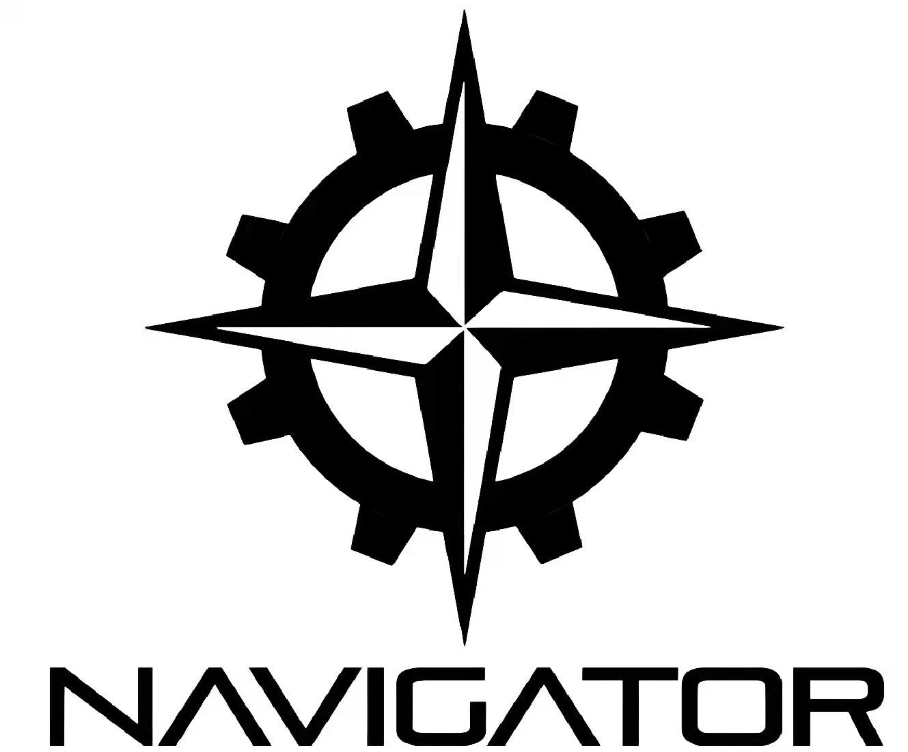

# info_relay

<p align="center">
  
</p>

**战队 / Team：** Navigator Vision Team  
**代码来源 / Source：** Navigator Vision Team，本仓库自研代码的文件头均标注来源与 MIT 标识。

串口与导航通信中转进程。整机唯一持有串口的程序：解析下位机协议后通过 iceoryx2 发布，
并接收视觉进程下发的云台指令写回串口。

本仓库与视觉自瞄工程完全解耦：不引用其源码、头文件、构建产物或运行产物，
可以独立克隆、独立构建、独立运行。

## 职责边界

| 负责 | 不负责 |
| --- | --- |
| 打开/关闭串口、断链重连 | 相机采集与推理 |
| 分帧、CRC、协议解析 | PnP、跟踪、瞄准决策 |
| 解析结果发布到 iceoryx2 | 录像与图像调试流 |
| 订阅视觉/导航指令并写串口 | 开火判据（由视觉侧决定） |
| — | ROS 2 节点与桥接（导航侧自行维护） |

## 依赖

编译期（Ubuntu，`sudo apt install`）：

```bash
build-essential cmake libyaml-cpp-dev libspdlog-dev libfmt-dev libeigen3-dev
```

跨进程通信库 iceoryx2 需**系统级安装**（与视觉工程共用同一份）：

```bash
git clone --depth 1 --branch v0.10.0 https://github.com/eclipse-iceoryx/iceoryx2.git
cmake -S iceoryx2 -B iceoryx2/build -DCMAKE_BUILD_TYPE=Release -DBUILD_EXAMPLES=OFF
cmake --build iceoryx2/build --parallel          # 需要 Rust 工具链（cargo）
sudo cmake --install iceoryx2/build --prefix /usr/local
```

本工程只维护一套 iceoryx2 中转通路；ROS 2 与 iceoryx2 的桥接由导航侧自行维护，
不在本仓库构建、链接或运行。

## 构建

```bash
cmake -S . -B build -DCMAKE_BUILD_TYPE=Release
cmake --build build --parallel
```

产物：

| 路径 | 说明 |
| --- | --- |
| `build/info_relay` | 中转进程 |
| `build/ipc_selftest` | 依赖与共享内存自检 |

## 运行

```bash
./build/info_relay configs/info_relay.yaml
# 或省略参数，等价于使用 <仓库根>/configs/info_relay.yaml
./build/info_relay
```

自检（不启动业务，只验证 iceoryx2 通路）：

```bash
./build/ipc_selftest        # 期望输出 PASS
```

## 路径约定

所有运行产物默认落在本仓库内，与启动时的当前目录无关：

| 用途 | 默认位置 | 可否修改 |
| --- | --- | --- |
| 运行日志 | `<repo>/logs/<启动时刻>.log` | 配置 `log_dir` |
| 串口字节录制 | `<repo>/records/relay_session/` | 配置 `record.dir` |
| 默认配置 | `<repo>/configs/info_relay.yaml` | 命令行参数 |
| 构建产物 | `<repo>/build/` | 由构建命令决定 |

仓库根按以下顺序确定：环境变量 `INFO_RELAY_HOME` → 可执行文件所在目录（在 `build/` 下则取其父目录）
→ 当前工作目录（并打印一次 warn）。因此从任意目录启动都写回仓库内。

## 与其他进程的契约

主题为 `<relay_prefix>/<topic>`，默认前缀 `rm_vision`。载荷为定长 POD，
定义见 `msg/relay_msgs.hpp`。

| 主题 | 载荷 | 频率 | 方向 |
| --- | --- | --- | --- |
| `imu` | `Imu` | 500 Hz | relay → 视觉 |
| `chassis` | `Chassis` | 100 Hz | relay → 视觉 |
| `robot` / `game` | `Robot` / `Game` | 1 Hz | relay → 视觉 |
| `health` | `Health` | 10 Hz | relay → 任意 |
| `cmd_aim` | `AimCmd` | 视觉帧率 | 视觉 → relay |
| `cmd_nav` | `NavCmd` | 导航帧率 | 视觉/导航 → relay |

`Health.schema_version` 用于运行期握手：视觉侧持有自己的线格式副本（`kSchemaVersion`），
两者不符时视觉侧会判链路失效。**修改 `msg/relay_msgs.hpp` 必须同时递增两侧的
`kSchemaVersion` 并同步字段**，只改一侧会导致握手失败。

## 许可证

本仓库自研代码由 Navigator Vision Team 所有，采用 **MIT License** 发布，完整条款见 [`LICENSE`](LICENSE)。
每个自研代码文件头部均带有 `SPDX-License-Identifier: MIT` 标识。

`3rdparty/serial` 为第三方代码，保留其上游版权声明与许可证；这部分文件不适用本仓库的上述 MIT 授权声明。
